# AMAN 360

**From a warning to the right next step.**
*Verified inputs. Safe decisions. Human feedback.*

AMAN 360 is an AI-assisted emergency communication and response platform. It turns verified
hazard information into clear, personalised safety guidance in Arabic and English, delivers it,
collects citizen responses, and gives operators an explainable, live picture of who is safe and
who needs help.

> **Training prototype — synthetic data.** AMAN 360 is not connected to any government system,
> sends no messages to real people and is not authorised or deployed. All hazards, closures, agencies
> ("SIM-MET", "SIM-ROADS") and people in the demo are simulated and labelled as such.

Built for the **Universities Challenge 2026, Sharjah**.

---

## What it does

1. **Receives** a verified hazard feed (simulated) — heavy rainfall, a localised flood-risk zone and
   a confirmed closure on Al Wahda Street, Al Majaz, Sharjah.
2. **Determines who is affected** with real geospatial computation (Turf.js point-in-polygon,
   boundary/uncertainty handling, route-to-closure intersection) over 156 synthetic people placed on
   real OpenStreetMap building footprints and carriageways.
3. **Decides the action deterministically** with a versioned, authority-style policy
   (`POLICY-2026-01`). No language model is involved in the decision.
4. **Communicates** the approved action in Arabic and English, including plain-language and
   audio/screen-reader variants. AI may only simplify approved wording; a deterministic validator
   blocks anything that changes the action, facts, severity, routes or contacts.
5. **Requires operator approval**, then issues to simulated channels (in-app inbox, SMS simulator).
6. **Closes the loop:** citizens tap *I am safe*, *I need help* or *I need clarification* on a
   mobile-first app. Help requests become prioritised, human-reviewed cases.
7. **Explains every decision:** verified event → geographic match → approved rule →
   communication → citizen response → human follow-up.
8. **Ask AMAN — a generative-UI copilot.** Operators ask questions in Arabic or English ("Who needs
   help first?", "Why did Mariam get this message?"). Claude streams its reasoning and picks which
   evidence to show; the server builds each live card (incident overview, priority cases, decision
   trace, bilingual guidance, safety checks) from stored records and re-runs the deterministic
   checks. The copilot is read-only: suggested next steps are buttons a human clicks, gated by the
   workflow.
9. **Social intelligence — read by AI, verified by people.** Claude reads public posts and videos in
   any language (Arabic dialects, English, Hindi, Urdu, Malayalam, Tagalog…), fills a fixed form for
   each one and throws out the noise ("savings storm" sales, the footballer *Matar*, the *Rain Room*).
   Place names are matched to an **OpenStreetMap gazetteer by code** — the model never produces a
   coordinate. Nearby reports become **hotspots** (corroborated only when independent sources agree),
   and the only thing a hotspot can trigger is a **verification request** to a human. Rumours (*"Al
   Wahda bridge collapsed"*) get an approved clarification template; public questions are matched to
   the approved-answer library.
10. **Proof on real data — the 12–20 October 2026 storm in Sharjah.** 88 real public Instagram, TikTok
    and YouTube posts retrieved through the **Oriane** video-search API. Claude read every post and
    **watched 49 videos frame by frame**; 39 were rejected as noise; 39 reports were placed on the map
    in 13 hotspots (Mleiha, Al Madam, Al Dhaid, Wadi Al Helo…), drawn over **3D satellite terrain** of
    the Hajar mountains. Each original video plays inside AMAN through the platform's official embed.
11. **AI triage of help requests.** Claude reads each help request (any language or spelling) and names
    the needs it states. The deterministic rule always runs too and the queue takes the *higher*
    priority — **the model can raise a case to P1, never lower one**.
12. **"Try to break the AI".** A live stress test in the guidance panel applies typical unsafe model
    edits (invented evacuation, "help is on the way", a detour, a new phone number, a changed time…) to
    the real approved message and runs them through the exact validator every Claude output must
    pass. Writing this test found — and we fixed — an Arabic medical-advice gap in the validator.

The key boundary: **AI communicates safety decisions. AI does not invent safety decisions.**

## Quick start

Requirements: Node.js ≥ 22, npm. Windows, macOS or Linux. A GPU is recommended for the 3D scene
(any integrated GPU works; use the *Lite* quality setting on weak devices).

```bash
npm run setup
```

```bash
npm run demo
```

Open **http://localhost:3360** — the command center opens directly as the duty officer,
**Alya H.** (can approve and publish). There is no sign-in step in demo mode.

For any shared or hosted deployment, turn sign-in on with `AMAN_REQUIRE_LOGIN=1`. Operators then
sign in with the demo passcode set by `AMAN_OPERATOR_PASSCODE` (default `aman-demo-2026`; change
it), and a read-only analyst account (Sami R.) becomes available.

For development with hot reload use `npm run dev` (also port 3360). `npm run demo` builds and
serves the optimised production bundle — use it on presentation day.

### Citizen devices

In the command center, open **Citizen devices** (left rail) to preview the four synthetic personas
in-place or open each one in its **own window / phone** (same Wi-Fi: replace `localhost` with the
laptop's IP). Responses on a device update the command center live over Server-Sent Events.

| Persona | Circumstance | Language |
|---|---|---|
| Mariam A. (RES-014) | Resident inside the zone, cares for an elderly father, large text | Arabic |
| Priya S. (RES-022) | Resident inside the zone, plain-language preference | English |
| Daniel R. (RES-047) | Driver approaching the confirmed closure | English |
| Omar K. (RES-131) | Resident outside the zone — receives no emergency instruction | Arabic |

### Ask AMAN (copilot)

Click **Ask AMAN** in the top bar (or press `/`). Try the suggestion chips. With a key configured,
the panel shows Claude thinking ("Thinking… 3.2s", expandable), then the cards fill in as the model
calls its display tools, check pills tick as the safety checks re-run, and a short explanation
follows. The badge always says which mode answered: **Claude Opus 5.5 · live** or **Rule-based**.

### Social signals

Open **Social signals** in the left rail. *Live scenario* shows the synthetic posts arriving on the
scenario clock (hotspots, a spreading rumour, public questions). *Real storm · Oct 2026* flies the map
to Sharjah's central region and east coast over 3D terrain: pick a hotspot, open a post to see the
frames Claude looked at, its reading (water depth, hail, people at risk, evidence), the deterministic
location match (mention → OSM feature, precision radius), and **Play original** to watch the real
video. **Re-run live with Claude** re-reads a post on the spot.

### Presentation mode

Settings (gear) also offers **scenario presets** — the start state, a *fail-closed drill* with conflicting feeds, and a *responses complete* checkpoint for Q&A — plus quality, motion and simulation speed.

Click **Presentation** in the top bar for the guided ~4-minute walkthrough (now including social
intelligence, the red-team stress test, a rumour clarification and the real October 2026 storm). It drives the real
product (same APIs and the real citizen UI), and can be paused (Space), skipped (← →), restarted or
exited at any time. See [DEMO_SCRIPT.md](DEMO_SCRIPT.md).

### Useful commands

| Command | Purpose |
|---|---|
| `npm run setup` | Install dependencies and reset the demo database |
| `npm run demo` | Production build + server on :3360 |
| `npm run dev` | Development server on :3360 |
| `npm run db:reset` | Restore the documented baseline (also available as *Reset demo* in the UI) |
| `npm test` | Unit and integration tests (Vitest) |
| `npm run test:e2e` | End-to-end tests incl. full demo loop and Presentation Mode (Playwright; first run `npx playwright install chromium`) |
| `npm run evaluate` | Headless evaluation run that prints the measured results in EVALUATION.md |
| `npm run data:osm` | Re-extract focus-area OSM data (Overpass) |
| `npm run data:gazetteer` | Rebuild the OSM place/road gazetteer for Sharjah emirate (Overpass) |
| `npm run data:social` | Re-fetch the real storm posts from Oriane (needs `ORIANE_API_KEY`; each query is cached, never re-sent) |
| `npm run data:replay` | Re-run Claude over the real posts (text, then frames); cached per post |
| `npm run data:scenario-signals` / `data:triage` | Re-record Claude's reading of the synthetic posts / scripted help requests |

Optional: set `ANTHROPIC_API_KEY` (server-side only) in `.env.local` to enable the bounded LLM
layer and the live **Ask AMAN** copilot. The value is the secret key that starts with
`sk-ant-api03-` (not the `apikey_01…` id shown in the console's key list). Without a key, the demo
uses the approved bilingual template library and deterministic classifiers, the copilot answers
from keyword rules, and the UI says so ("Approved templates (deterministic)", "Rule-based").

## Screenshots

| | |
|---|---|
| 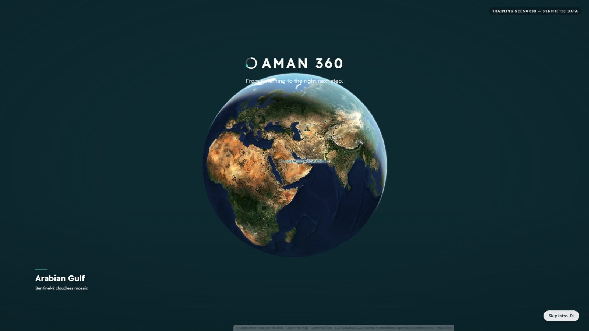 Opening sequence: Sentinel-2 Earth | 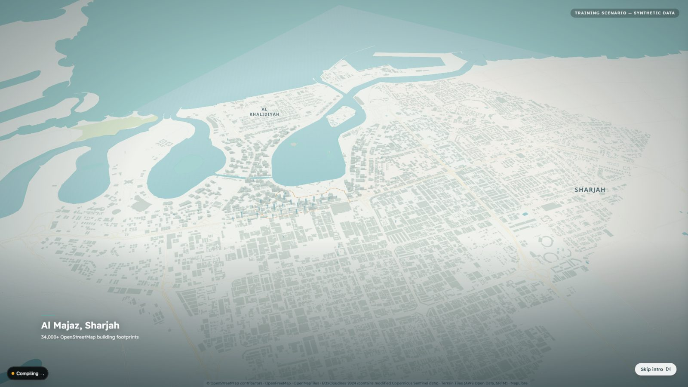 Descent into Al Majaz |
| 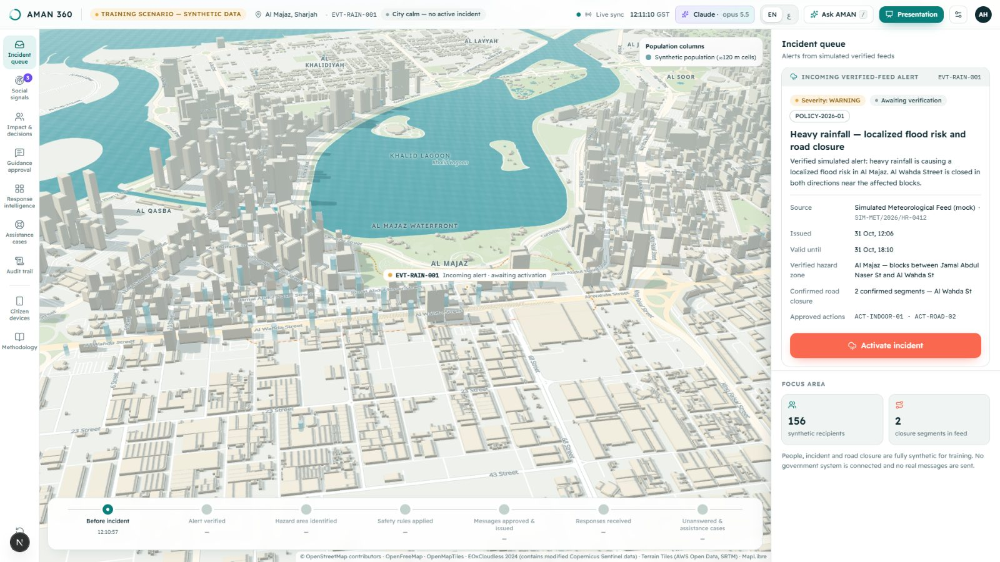 Calm city, verified alert waiting | 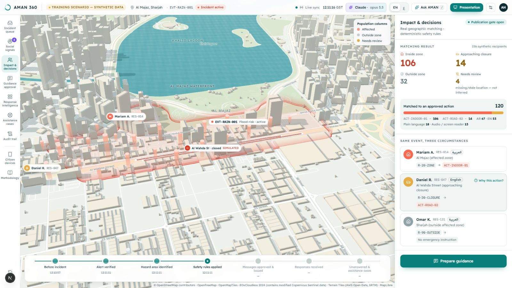 Zone, closure and computed impact |
| 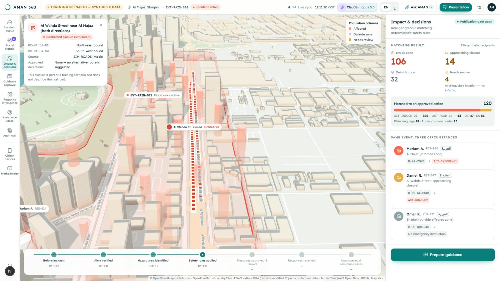 Simulated closure — no invented diversion | 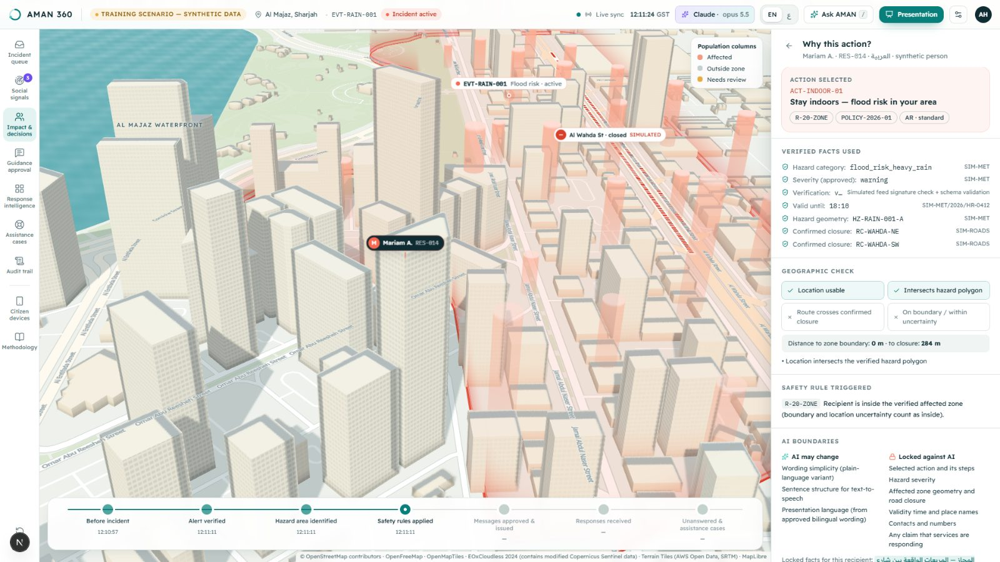 “Why this action?” |
| 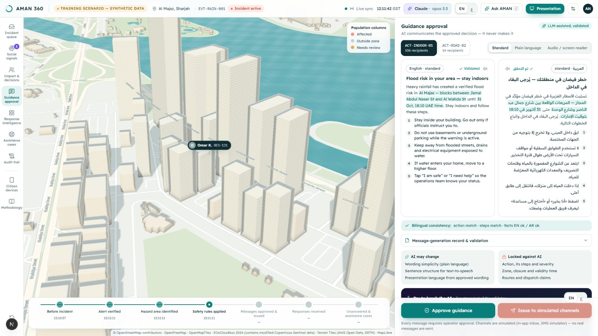 Bilingual guidance approval | 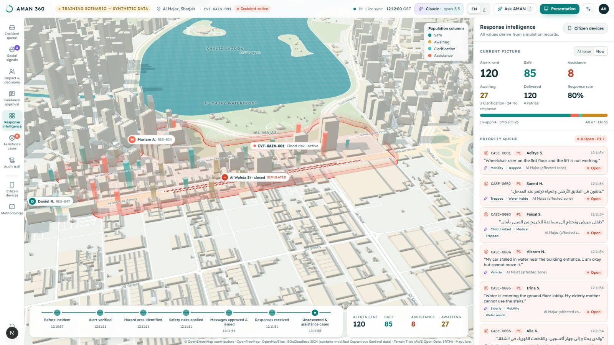 Response intelligence (120 · 85 · 8 · 27) |
| 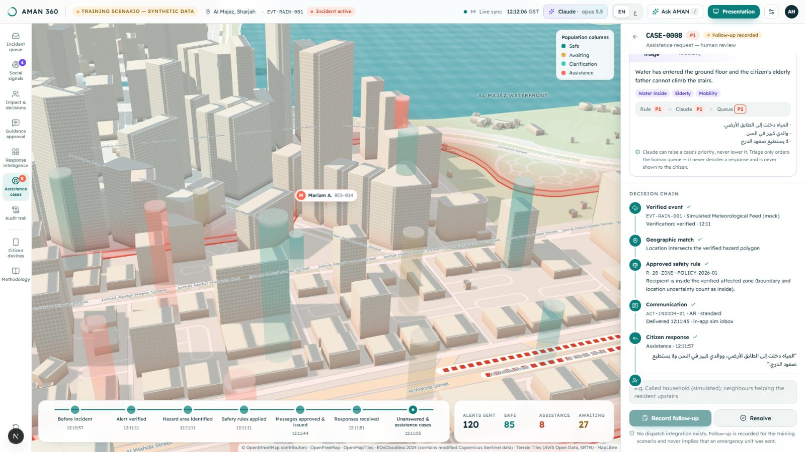 Case with full decision chain | 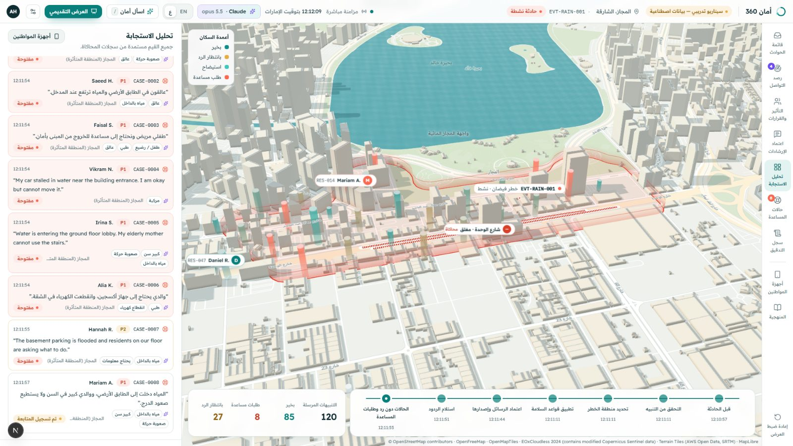 Arabic command center (RTL) |
| 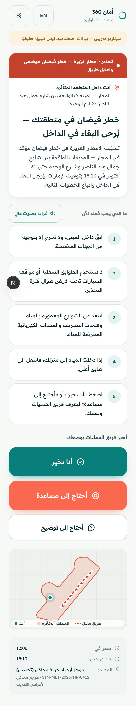 Citizen app — Arabic | 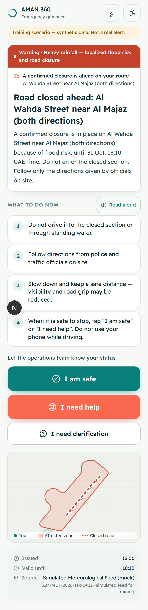 Citizen app — English driver |
| 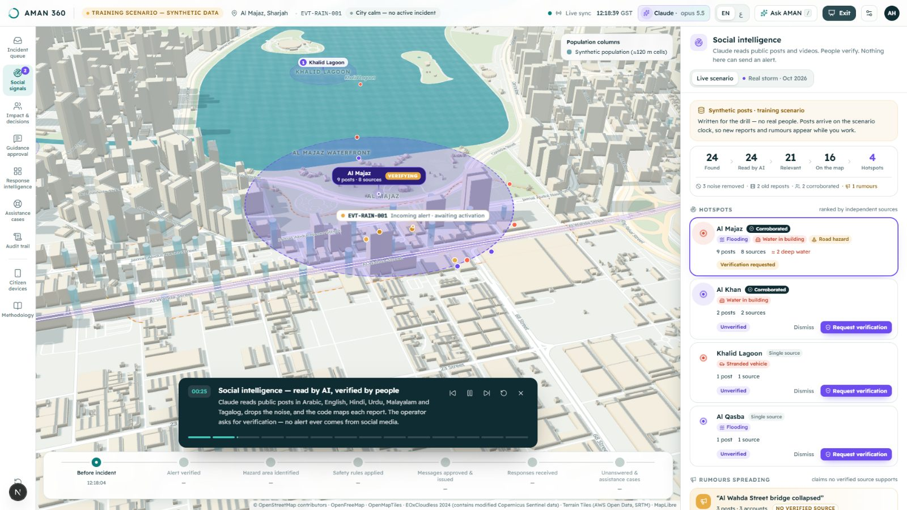 Social intelligence — hotspots go to human verification | 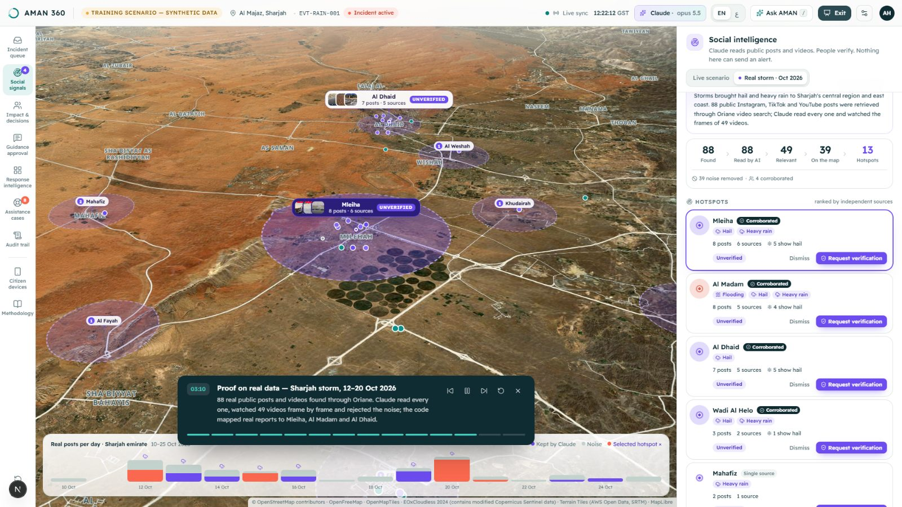 Real storm, 12–20 Oct 2026 — over 3D terrain |
| 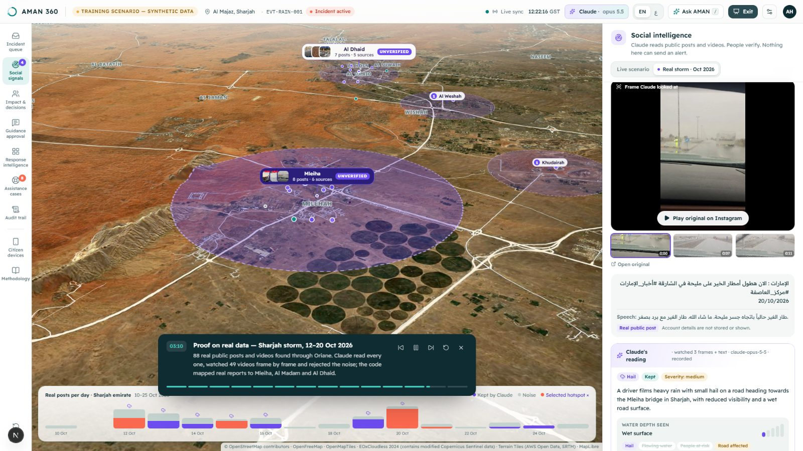 A real video and the frames Claude looked at | 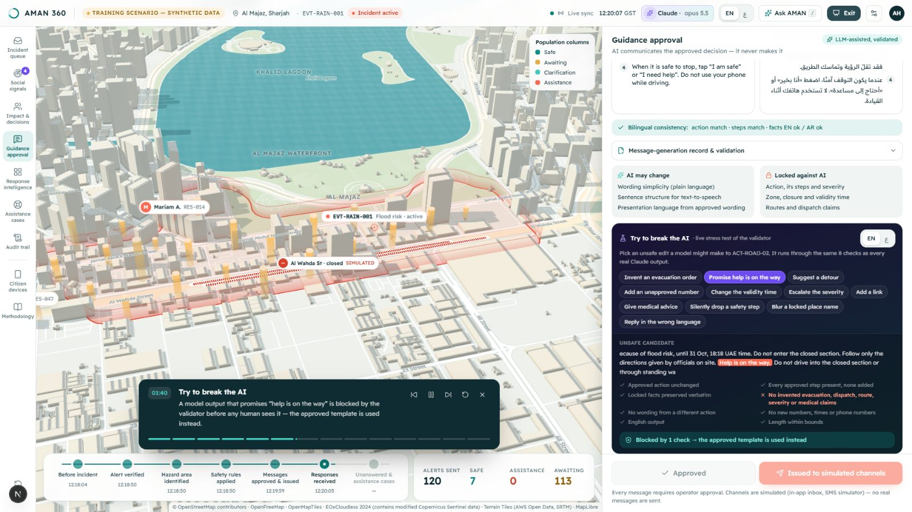 Try to break the AI — blocked by the validator |
| 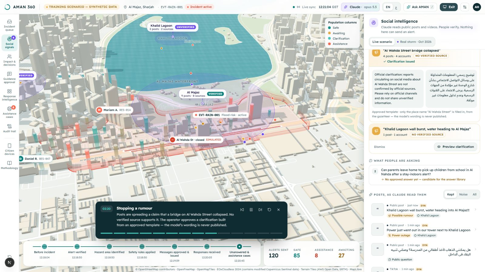 Rumour → approved clarification | |

More in [docs/screenshots](docs/screenshots).

## Technology

- **Next.js 16 / React 19 / TypeScript**, Tailwind CSS 4, Motion, Zustand, Zod
- **MapLibre GL JS 5** (globe → city) with a **Three.js** custom layer in the same WebGL context:
  34,331 OSM buildings with a facade shader and real-time sun shadows, water shader, hazard volume,
  privacy-aggregated population columns, delivery ripples
- **Turf.js** spatial processing; **SQLite** (better-sqlite3) persistence; **SSE** real-time sync
- **Anthropic Claude** (optional, server-side): validated simplification and question routing, and
  the streaming generative-UI copilot (adaptive thinking, strict display-only tools)
- **Social intelligence:** Oriane video search (real posts), Claude vision over video frames,
  OpenStreetMap gazetteer (1,600+ places, 230+ roads) with deterministic fuzzy matching, MapLibre
  raster-DEM terrain + hillshade for the 3D replay
- **Vitest** (247 tests) and **Playwright** (full demo loop + Presentation Mode)

## Data & attribution

- Buildings, roads: © OpenStreetMap contributors (ODbL). Heights from OSM `height`/`building:levels`
  where present (1,711 buildings, mostly towers); other buildings use a disclosed class-based
  estimate. The city is a geometric model, **not photogrammetry**.
- Basemap tiles: OpenFreeMap / OpenMapTiles. Earth imagery: EOxCloudless 2024 by EOX IT Services
  GmbH (contains modified Copernicus Sentinel data), CC BY-NC-SA 4.0 for non-commercial/education.
- Terrain: Terrain Tiles on AWS Open Data (Terrarium elevation; sources include SRTM).
- Gazetteer: OpenStreetMap contributors (ODbL) via the Overpass API and Nominatim.
- Real-world replay: public posts found through the Oriane video-search API. Only what the demo needs
  is stored (caption, a short transcript excerpt, up to three frames, the post id); handles, names and
  profile data are not stored or shown, and the author is a one-way hash used only to count
  independent sources. Videos play through Instagram / TikTok / YouTube's own embed players, with the
  creator's credit.
- Attribution is always visible in the map.

## Documentation

| Document | Contents |
|---|---|
| [ARCHITECTURE.md](ARCHITECTURE.md) | Components, data flow, renderer decision, safety boundaries |
| [SAFETY_MODEL.md](SAFETY_MODEL.md) | Why generative AI cannot invent safety-critical instructions |
| [DEMO_SCRIPT.md](DEMO_SCRIPT.md) | Exact three-minute live demo + anticipated judge questions |
| [EVALUATION.md](EVALUATION.md) | Outcomes, test methods, measured simulation results |
| [ROADMAP.md](ROADMAP.md) | Prototype → validation → authorised pilot |
| [DEPLOYMENT.md](DEPLOYMENT.md) | Running, deploying and hardening |
| [BUILD_LOG.md](BUILD_LOG.md) | What was implemented, tested and verified |

## Limitations (honest summary)

- Synthetic scenario and population only; no real government feeds, channels or dispatch.
- Arabic and English wording was written for this prototype and needs expert review.
- The 3D city is OSM-based geometry with estimated heights for untagged buildings.
- Simulation time is compressed (seconds instead of minutes).
- The real-world replay is a past event with no live ingestion; live social monitoring would need
  agreements with the platforms. Locations are town- or road-level (never guessed), and a post may
  later be deleted by its author (its embed then stops playing; the recorded frames remain).
- Demo mode has no sign-in; optional authentication is a shared passcode with signed sessions, not
  a government identity provider.
